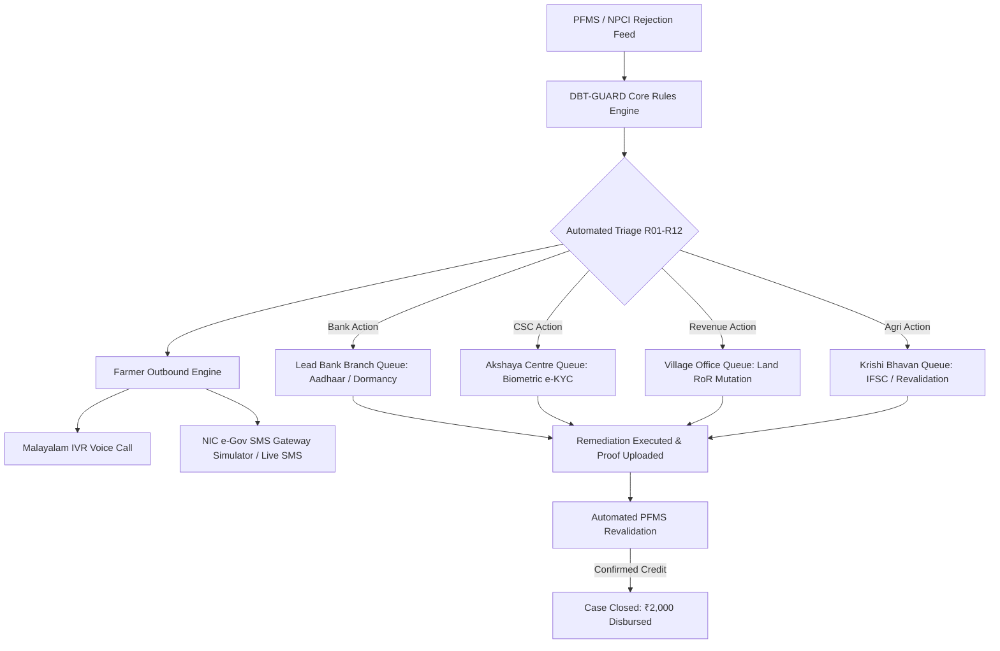

# 🌾 DBT-GUARD: PM-KISAN DBT Beneficiary Resolution Platform

> **Detect. Explain. Contact. Resolve.**  
> India's first closed-loop, vernacularDirect Benefit Transfer (DBT) beneficiary remediation platform designed to eliminate the last-mile banking blindspot between PFMS central payment gateways, NPCI Aadhaar seeding, and grassroots Krishi Bhavans.

Developed for **She Builds Tech 3.0 (Open Innovation in FinTech)**  
**Team NPS** • **Christ College of Engineering, Irinjalakuda**  
*Ann Rose P T • Ann Sani • Merin Joy • Pawrnami Omprakash*

---

## 📌 Problem Overview
Every disbursement cycle under PM-KISAN, millions of rightful smallholder farmers face silent installment failures without actionable feedback. Opaque banking error codes (`E01 NPCI Inactive`, `E02 Dormant Account`, `E03 Land Mutation Discrepancy`) leave farmers trapped in a triangular run-around between Bank Branches, Krishi Bhavans, and Akshaya CSC centres.

---

## 🌟 10 Key Contributions & Innovations

### 1. Closed-Loop "Credit-Confirmed" Resolution Lifecycle
Unlike standard grievance portals that close tickets upon officer remarks, DBT-GUARD enforces a verified closed-loop model. A case remains open until banking/PFMS status revalidation confirms the ₹2,000 credit in the beneficiary's account.

### 2. 12-Rule Automated Multi-Agency Triage Engine (R01–R12)
Normalizes cryptic PFMS/NPCI exception codes and automatically maps each case to the exact responsible authority (Lead Bank Branch, Krishi Bhavan, Akshaya Centre, or Village Office) with targeted remediation protocols, eliminating inter-departmental buck-passing.

### 3. Native Malayalam Vernacular Voice Assist (IVR & Telephony)
Overcomes rural digital and literacy barriers through automated outbound Malayalam voice synthesis and pre-recorded native audio announcements, delivering spoken instructions on required physical documents and specific local offices to visit.

### 4. 4-Stage In-Browser NIC e-Gov SMS Gateway Simulator & Real Telecom Bridge
Features a high-fidelity simulation of the government telecom pipeline (TRAI DLT Template validation → NIC SMS Hub → BTS Cellular Tower → Handset DLR Delivery) paired with live telecom failovers (Fast2SMS, Twilio, WhatsApp) and an interactive virtual smartphone display.

### 5. Zero-Trust RBAC & DPDP Act 2023 Compliant Data Isolation
Provides 6 specialized role portals (Farmer, Krishi Bhavan Officer, Lead Bank Branch, Akshaya Centre, Village Office, District Nodal Officer) with masked PII (`XXXX-XXXX-4921`) and cryptographic tenant isolation ensuring farmers only access their own records.

### 6. Offline-Resilient Browser-First Edge Architecture
Engineered on React, TypeScript, Vite, Tailwind CSS, Zustand, and LocalStorage, enabling the entire 1,000-case database, rule engine, and audit logging to execute with near-zero latency directly in-browser on low-spec rural desktops without mandatory server dependencies.

### 7. Automated SLA Tracking & District Nodal Escalation Matrix
Monitors case aging with color-coded severity badges (`Green`, `Amber`, `Red`). Overdue cases (>7 days) automatically escalate to the District Nodal Collector's dashboard, preventing cases from slipping past statutory disbursement windows.

### 8. Immutable Chronological Audit Trail for Inter-Agency Accountability
Maintains a tamper-evident event log recording every touchpoint—timestamp, officer name, action taken, documents uploaded, and revalidation status—ensuring complete administrative transparency across departments.

### 9. Actionable Pre-Filled Resolution Cards & Banking Mandates
Generates instant, human-readable Action Cards with pre-filled NPCI Aadhaar-linking mandate forms (Annexure-I), specific branch IFSCs, and document checklists, reducing physical farmer visits from an average of 3 visits down to a single targeted trip.

### 10. Data-Driven Macro Bottleneck Analytics for SLBC Policy
Aggregates grassroots failure patterns to provide District Collectors and State Level Bankers' Committees (SLBC) real-time visibility into systemic failure clusters (e.g., mass de-linking post bank mergers), enabling targeted mobile IPPB doorstep camps.

---

## 🏛️ System Architecture



---

## 👥 Role-Based Access Control (RBAC)

| Role | Access Scope & Key Responsibilities |
|:---|:---|
| **Farmer** | Isolated personal view: payment status, nearest office, vernacular voice advisory |
| **Krishi Bhavan Officer** | Block jurisdiction, remediation queue, camp scheduling, batch revalidation |
| **Lead Bank Branch** | Mandate verification, NPCI mapper activation, account unfreezing |
| **Akshaya Centre** | Biometric e-KYC authentication, Aadhaar demographics correction |
| **Village Office** | Land survey RoR reconciliation, cadastre mutation clearance |
| **District Nodal Officer** | Macro MIS analytics, overdue SLA escalations, inter-agency reporting |

---

## 🛠️ Tech Stack

- **Frontend Framework:** React 19 + TypeScript
- **Build Tool:** Vite
- **Styling:** Tailwind CSS (Accessible Government & FinTech Theme)
- **State Management:** Zustand with LocalStorage persistence
- **Icons & Typography:** Material Symbols, Noto Sans Malayalam, Inter
- **Telecom & Voice:** Web Audio API, NIC SMS Simulator, Fast2SMS / Twilio Bridges

---

## 🚀 Getting Started

### Prerequisites
- Node.js (v18 or higher)
- npm or pnpm

### Installation
```bash
# Clone the repository
git clone https://github.com/AnnRosePT/DBT-GUARD.git
cd DBT-GUARD

# Install dependencies
npm install

# Start development server
npm run dev
```

Visit `http://localhost:5173` to explore the platform.

---

## 👩‍💻 Team NPS — Christ College of Engineering, Irinjalakuda
- **Ann Rose P T**
- **Ann Sani**
- **Merin Joy**
- **Pawrnami Omprakash**

*Submitted for She Builds Tech 3.0 · Open Innovation in FinTech*
